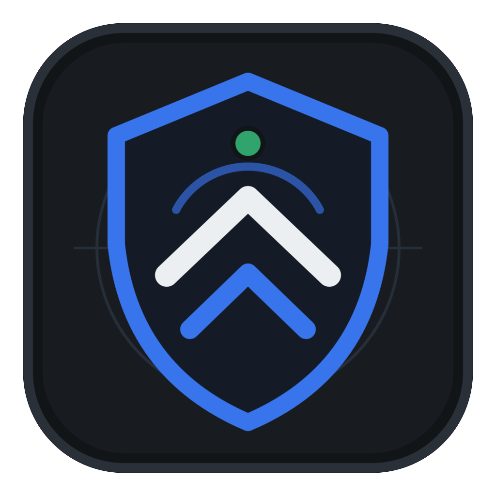

<p align="center">
  
</p>

<h1 align="center">JenderalScan</h1>

<p align="center">
  <strong>Non-Intrusive Desktop Web Vulnerability Surface Scanner · Go + Wails v2 + React</strong>
</p>

JenderalScan adalah aplikasi desktop lintas platform (**macOS**, **Windows**, dan **Linux**) untuk mengaudit permukaan keamanan (*security surface*) sebuah website yang Anda miliki atau yang telah memberikan izin tertulis resmi.

Berbeda dari *offensive exploitation tools*, JenderalScan berfokus pada **deteksi kelemahan konfigurasi secara non-intrusif** — menyatukan pemeriksaan *security headers*, *TLS/SSL*, *cookie flags*, *path/file sensitif*, *deep tech & language fingerprinting*, *pencocokan & estimasi CVE*, *CORS*, *information disclosure*, *DNS & passive subdomain*, serta *lightweight port checks* dalam satu antarmuka instrumen desktop tanpa ketergantungan CLI eksternal.

---

## Daftar Isi

1. [Fitur Lengkap JenderalScan](#1-fitur-lengkap-jenderalscan)
   - [10 Modul Pemeriksaan Keamanan](#a-10-modul-pemeriksaan-keamanan)
   - [Deteksi Mendalam Bahasa Pemrograman & Framework](#b-deteksi-mendalam-bahasa-pemrograman--framework)
   - [Pencocokan & Estimasi CVE Dua Tingkat (Offline)](#c-pencocokan--estimasi-cve-dua-tingkat-offline)
   - [Guardrails Legal & Akuntabilitas Bawaan](#d-guardrails-legal--akuntabilitas-bawaan)
   - [Fitur Pendukung Workbench & Ekspor Laporan](#e-fitur-pendukung-workbench--ekspor-laporan)
2. [Arsitektur Proyek](#2-arsitektur-proyek)
3. [Panduan Instalasi & Kompilasi (macOS, Windows, Linux)](#3-panduan-instalasi--kompilasi-macos-windows-linux)
   - [Prasyarat Umum](#prasyarat-umum)
   - [Kompilasi & Instalasi di macOS](#a-kompilasi--instalasi-di-macos-apple-silicon--intel)
   - [Kompilasi & Instalasi di Windows](#b-kompilasi--instalasi-di-windows-1011)
   - [Kompilasi & Instalasi di Linux](#c-kompilasi--instalasi-di-linux-ubuntudebianfedoraarch)
4. [Cara Menjalankan & Menguji](#4-cara-menjalankan--menguji)
5. [Lisensi & Disclaimer Penggunaan Legal](#5-lisensi--disclaimer-penggunaan-legal)

---

## 1. Fitur Lengkap JenderalScan

### A. 10 Modul Pemeriksaan Keamanan

Setiap modul berjalan secara independen di atas *worker pool* paralel Go yang dikendalikan oleh *token-bucket rate limiter*. Kegagalan jaringan pada satu modul tidak akan menggagalkan modul lainnya.

| No | ID Modul | Nama Modul | Fase | Cakupan Pemeriksaan Detail | Severity Khas |
| :-: | :--- | :--- | :-: | :--- | :-: |
| 1 | `headers` | **Security Headers** | MVP | Memeriksa keberadaan dan kekuatan `Strict-Transport-Security` (HSTS & durasi `max-age >= 31536000`), `Content-Security-Policy` (CSP & deteksi direktif berisiko `'unsafe-inline'` / `'unsafe-eval'`), `X-Frame-Options` / CSP `frame-ancestors` (anti-Clickjacking), `X-Content-Type-Options: nosniff`, `Referrer-Policy`, `Permissions-Policy`, dan `Cross-Origin-Opener-Policy` (COOP). | Low–Medium |
| 2 | `tls` | **Konfigurasi TLS/SSL** | MVP | Menginspeksi koneksi HTTPS & sertifikat X.509 secara langsung: mendeteksi situs tanpa HTTPS atau HTTP yang tidak otomatis dialihkan ke HTTPS, masa berlaku sertifikat (kedaluwarsa atau akan habis < 30 hari), ketidakcocokan *hostname* (SAN), sertifikat *self-signed*, rantai sertifikat (*intermediate chain*) tidak lengkap, kunci publik RSA lemah (< 2048-bit), algoritma tanda tangan usang (SHA-1/MD5), *cipher suite* non-AEAD/lemah (CBC, 3DES, RC4), serta dukungan protokol usang (**TLS 1.0** dan **TLS 1.1**). | Medium–High |
| 3 | `cookies` | **Cookie Flags** | MVP | Menginspeksi seluruh header `Set-Cookie` lintas *redirect*: memeriksa atribut `Secure`, `HttpOnly`, dan `SameSite` (`Strict`/`Lax`/`None`), mendeteksi `SameSite=None` tanpa `Secure`, serta menaikkan tingkat keparahan secara otomatis untuk cookie sesi/autentikasi (`PHPSESSID`, `laravel_session`, `JSESSIONID`, `token`, `sid`, dll.). | Low–Medium |
| 4 | `paths` | **Path & File Sensitif** | MVP | Pemeriksaan non-destruktif terhadap tereksposnya `/.git/HEAD`, `/.git/config`, `/.env`, `/phpinfo.php`, `/actuator/env`, `/actuator/health` (Spring Boot), `/server-status` (Apache), `/wp-config.php.bak`, `/backup.sql`, `/.DS_Store`, `/swagger.json`, `/openapi.json`, serta analisis entri sensitif pada `/robots.txt`. Dilengkapi **Kalibrasi Anti-False-Positive (Soft-404 SPA Calibration)** yang membandingkan respons dengan *baseline* 404 acak dan tanda tangan konten agar aplikasi *Single Page Application* (SPA) tidak menghasilkan *false positive*. | Medium–High |
| 5 | `fingerprint` | **Tech Fingerprint** | MVP | Mengidentifikasi bahasa pemrograman, runtime, web server, framework backend/frontend, CMS, pustaka JS/CSS, dan CDN/WAF dari header HTTP, cookie, meta tag, pola URL aset, serta atribut DOM HTML. | Info |
| 6 | `cve` | **Pencocokan & Estimasi CVE** | v1 | Memetakan komponen teknologi dan versi hasil *fingerprint* terhadap basis data kerentanan CVE lokal secara *offline* (mendukung pencocokan versi eksak maupun estimasi potensi CVE ketika versi disembunyikan). | Low–High |
| 7 | `cors` | **Konfigurasi CORS** | v1 | Menguji kebijakan *Cross-Origin Resource Sharing* secara aman: mendeteksi pantulan *Origin* sembarang (*Arbitrary Origin Reflection*), kombinasi berbahaya dengan `Access-Control-Allow-Credentials: true`, kepercayaan pada `Origin: null`, serta *bypass* validasi awalan (*prefix*) domain. | Medium–High |
| 8 | `disclosure` | **Information Disclosure** | v1 | Mendeteksi eksposur versi detail pada banner server/runtime (`Server`, `X-Powered-By`, `X-AspNet-Version`), kebocoran alamat IP jaringan privat internal (**RFC 1918**: `10.x.x.x`, `172.16-31.x.x`, `192.168.x.x`), *Directory Listing* aktif (`Index of /`), *stack trace* / pesan error *debug* (PHP, Laravel Whoops, Django, ASP.NET, Java, SQL), komentar HTML pengembang yang memuat kata kunci sensitif (`TODO`, `FIXME`, `password`, `secret`, `token`, `staging`), serta keberadaan standar RFC 9116 `/.well-known/security.txt`. | Low–Medium |
| 9 | `dns` | **DNS & Subdomain Pasif** | v2 | Mengambil inventaris record DNS (`A`, `AAAA`, `CNAME`, `NS`, `MX`, `TXT`), memeriksa postur keamanan anti-spoofing email (**SPF** `v=spf1` & **DMARC** `_dmarc`), serta melakukan enumerasi subdomain secara **100% pasif** melalui log publik *Certificate Transparency* (`crt.sh`). | Info–Medium |
| 10 | `ports` | **Port & Service Ringan** | v2 | Pemeriksaan koneksi TCP ringan dan dibatasi *rate limit* pada port layanan web standar (`80`, `443`, `8080`, `8443`) serta port manajemen/database yang berisiko tinggi bila tidak sengaja terbuka ke jaringan publik (`21` FTP, `22` SSH, `23` Telnet, `3306` MySQL, `5432` PostgreSQL, `6379` Redis, `27017` MongoDB) beserta pembacaan *banner* pasif. | Info–High |

---

### B. Deteksi Mendalam Bahasa Pemrograman & Framework

Modul `fingerprint` tidak hanya membaca header `Server`, tetapi juga mengenali tanda tangan spesifik framework dan menyimpulkan bahasa pemrograman utamanya secara otomatis:

- **PHP**:
  - **Laravel** (cookie `laravel_session`, `XSRF-TOKEN`, `laravel_token`, `<meta name="csrf-token">` 40 karakter, bundle Vite `/build/assets/app-`), **Laravel Livewire** (`wire:id`, `wire:snapshot`, `/livewire/livewire.js`), **Inertia.js** (`data-page`), **Symfony** (`X-Debug-Token`), **CodeIgniter** (`ci_session`), **Yii Framework** (`_csrf-frontend`), **WordPress** (`/wp-content/`, header `api.w.org`, ekstraksi versi dari `?ver=` pada `wp-emoji-release.min.js`), **Drupal**, **Joomla**.
- **Go (Golang)**:
  - **Gin**, **Go Fiber**, **Echo**, **Fasthttp**, **Caddy**, **Traefik**, **MinIO**, **Hugo**, **Gitea** (`i_like_gitea`), **Grafana** (`grafana_session`).
- **Rust**:
  - **Actix-web** (header `actix-web` atau cookie `actix-session`), **Axum**, **Hyper**, **Rocket**, **Warp**, **Pingora**, **Deno**, **Zola**.
- **Node.js / JavaScript / TypeScript**:
  - **Express** (`connect.sid`), **Next.js** (`__NEXT_DATA__`, `/_next/static/`, `x-nextjs-cache`), **Nuxt.js** (`__NUXT__`), **Remix** (`__remixContext`), **SvelteKit** (`__sveltekit`), **Astro** (`<astro-island>`), **NestJS**, **Fastify**, **Koa**, **AdonisJS**, **Angular** (`ng-version`), **React**, **Vue.js**, **jQuery**, **Bootstrap**, **Alpine.js** (`x-data`), **HTMX** (`hx-get`/`hx-post`), **Tailwind CSS**.
- **Python**:
  - **Django** (`csrftoken`, `WSGIServer`), **Flask / Werkzeug**, **FastAPI / Uvicorn**, **Gunicorn**, **Tornado**.
- **Java / .NET / Ruby / Elixir**:
  - **Spring Boot / Java Servlet** (`JSESSIONID`), **Apache Tomcat**, **Jetty**, **WildFly**, **ASP.NET Core** (`.AspNetCore.*`, `Kestrel`), **Microsoft-IIS**, **Ruby on Rails** (`_rails_session`, `Puma`), **Cowboy / Elixir**.

---

### C. Pencocokan & Estimasi CVE Dua Tingkat (Offline)

Modul `cve` bekerja 100% *offline* menggunakan basis data NVD terkurasi bawaan + penyimpanan kustom SQLite dengan dua tingkat deteksi:

1. **Tingkat 1 — Pencocokan Versi Eksak (`Confidence: High`)**:
   Saat nomor versi terlihat pada target (mis. `Apache 2.4.49`, `PHP 8.1.2`, `WordPress 6.3.1`, `jQuery 3.4.1`, `OpenSSL 1.1.1k`), mesin membandingkan versi secara semantik (`versionStart <= v < versionEnd`) dan melaporkan CVE spesifik beserta skor CVSS v3.
2. **Tingkat 2 — Estimasi Potensi CVE Berbasis Teknologi (`Confidence: Low`)**:
   Saat teknologi berhasil dideteksi (misalnya **Laravel**, **Go**, **Rust / Actix-web**, **Next.js**, **Express**, **Django**, atau **Spring Boot**) namun administrator menyembunyikan nomor versinya dari publik, JenderalScan tetap menyajikan **estimasi daftar CVE paling kritis untuk teknologi tersebut** beserta batas versi amannya agar tim pengembang dapat langsung memverifikasi pada file `composer.lock`, `go.mod`, `Cargo.lock`, atau `package-lock.json`.

---

### D. Guardrails Legal & Akuntabilitas Bawaan

1. **Konfirmasi Wewenang Wajib**: Tombol *Mulai pemindaian* dinonaktifkan di UI dan ditolak secara keras oleh Go Engine apabila pernyataan kepemilikan/izin tertulis (`AuthorizedConfirm`) tidak dicentang.
2. **Host Scope Lock**: Setiap request HTTP dan pengalihan (*redirect*) dikunci ketat pada hostname target awal; pengalihan ke domain pihak ketiga atau subdomain di luar lingkup dihentikan otomatis.
3. **Rate Limiter Bawaan**: Membatasi jumlah request per detik (default `10 req/detik`, dapat diatur di Pengaturan) agar pemeriksaan tidak membebani target.
4. **Jejak Legal (Audit Trail)**: Setiap sesi pemindaian dicatat secara permanen ke tabel `audit_logs` SQLite (mencakup waktu mulai, URL target, profil, modul yang dijalankan, konfirmasi izin, catatan referensi tiket/kontrak, dan jumlah temuan).
5. **100% Lokal & Privat**: Seluruh data disimpan di SQLite lokal (`modernc.org/sqlite`, *pure-Go* tanpa Cgo) pada direktori konfigurasi pengguna dan tidak pernah dikirim ke server eksternal.

---

### E. Fitur Pendukung Workbench & Ekspor Laporan

- **Setiap Temuan Actionable**: Seluruh temuan dilengkapi penjelasan **Deskripsi temuan** (*Apa ini*), **Dampak keamanan** (*Kenapa berisiko*), **Rekomendasi perbaikan** (*Cara perbaiki*), **Bukti teknis** (*Evidence* dengan tombol salin), serta referensi **OWASP Top 10 & CWE**.
- **Perbandingan Riwayat (Scan Diffing)**: Otomatis membandingkan hasil scan terbaru dengan scan sebelumnya pada host yang sama, menandai **Temuan baru (`new`)**, **Temuan berulang (`recurring`)**, serta daftar **Temuan teratasi (`fixed`)**.
- **Server Uji Lokal (Sandbox Target)**: Tombol *"Muat server uji lokal"* menyalakan server HTTP lokal aman di `127.0.0.1` untuk menguji seluruh 10 modul deteksi secara legal tanpa menyentuh jaringan luar.
- **4 Format Ekspor Sekali Klik**:
  - **JSON** (`.json`): Data terstruktur lengkap untuk integrasi CI/CD atau pengolahan mesin.
  - **Markdown** (`.md`): Laporan GitHub-Flavored Markdown siap tempel ke GitHub Issue, Pull Request, Notion, atau Obsidian.
  - **HTML** (`.html`): Laporan audit eksekutif & teknis mandiri (*self-contained*) yang rapi dan siap cetak.
  - **PDF** (`.pdf`): Dokumen PDF 1.4 multi-halaman yang dihasilkan secara *native* oleh Go tanpa memerlukan Chrome/wkhtmltopdf.
- **Dwi-Bahasa (`ID` / `EN`) & Tema Instrumen (`Gelap` / `Terang`)**: Seluruh antarmuka dan laporan yang diekspor mendukung Bahasa Indonesia dan Bahasa Inggris.

---

## 2. Arsitektur Proyek

```text
jenderalscan/
├── main.go                     # Entrypoint Wails desktop GUI & mode --web
├── app.go                      # Binding IPC Wails, manajemen Sandbox, & REST/SSE bridge
├── wails.json                  # Konfigurasi proyek Wails v2
├── .goreleaser.yaml            # Konfigurasi cross-compile & rilis multi-OS
├── internal/
│   ├── models/                 # Definisi struct domain, modul, temuan, & pengaturan
│   ├── storage/                # Penyimpanan SQLite pure-Go, diffing scan, & audit log
│   ├── engine/                 # Orkestrator worker pool, rate limiter, & Scope Lock
│   ├── modules/                # Implementasi 10 modul scanner + dataset CVE lokal
│   └── report/                 # Generator laporan JSON, Markdown (.md), HTML, & PDF
└── frontend/                   # Antarmuka React + Vite + Tailwind CSS
    └── src/
        ├── App.jsx             # Workbench UI (6 tampilan utama)
        ├── bridge.js           # Jembatan IPC Wails & fallback HTTP/SSE
        ├── i18n.js             # Kamus terjemahan Bahasa Indonesia & Inggris
        └── index.css           # Sistem token warna & tipografi instrumen
```

---

## 3. Panduan Instalasi & Kompilasi (macOS, Windows, Linux)

### Prasyarat Umum (Semua Sistem Operasi)

Pastikan ketiga perangkat berikut telah terpasang di komputer Anda:

1. **Go** versi **1.24** atau lebih baru — [https://go.dev/dl/](https://go.dev/dl/)
2. **Node.js** versi **18+** (disarankan **v20 / v22 LTS**) beserta `npm` — [https://nodejs.org/](https://nodejs.org/)
3. **Wails v2 CLI**:
   ```bash
   go install github.com/wailsapp/wails/v2/cmd/wails@latest
   ```
   *(Pastikan direktori `$(go env GOPATH)/bin` atau `~/go/bin` sudah masuk ke dalam variabel environment `PATH` Anda).*

Verifikasi kesiapan environment dengan menjalankan:
```bash
wails doctor
```

---

### A. Kompilasi & Instalasi di macOS (Apple Silicon & Intel)

1. **Pasang Xcode Command Line Tools** (jika belum ada):
   ```bash
   xcode-select --install
   ```
2. **Kloning repositori & masuk ke direktori proyek**:
   ```bash
   git clone git@github.com:mohammadirham37/jenderalscan.git
   cd jenderalscan
   ```
3. **Build paket aplikasi `.app` macOS**:
   - Untuk arsitektur mesin saat ini (`arm64` atau `amd64`):
     ```bash
     wails build
     ```
   - Untuk membuat **Universal Binary** (berjalan di Apple Silicon M1/M2/M3/M4 sekaligus Intel Mac):
     ```bash
     wails build -platform darwin/universal
     ```
4. **Lokasi hasil build & instalasi ke folder Applications**:
   Hasil kompilasi berada di `build/bin/JenderalScan.app`. Anda dapat langsung membukanya atau memindahkannya ke `/Applications`:
   ```bash
   cp -R build/bin/JenderalScan.app /Applications/
   open /Applications/JenderalScan.app
   ```

---

### B. Kompilasi & Instalasi di Windows (Windows 10 / 11)

1. **Prasyarat Windows**:
   - Windows 10 (versi 1803+) dan Windows 11 sudah menyertakan **Microsoft Edge WebView2 Runtime** secara bawaan.
   - *(Opsional untuk membuat installer NSIS)*: Pasang NSIS melalui Winget atau Chocolatey:
     ```powershell
     winget install NSIS.NSIS
     ```
2. **Kloning repositori di PowerShell / Command Prompt**:
   ```powershell
   git clone git@github.com:mohammadirham37/jenderalscan.git
   cd jenderalscan
   ```
3. **Build aplikasi `.exe` Windows**:
   - Build executable mandiri (`jenderalscan.exe`):
     ```powershell
     wails build -platform windows/amd64
     ```
   - Build beserta paket **Installer Windows (`-nsis`)**:
     ```powershell
     wails build -platform windows/amd64 -nsis
     ```
4. **Lokasi hasil build**:
   - File aplikasi siap pakai tersedia di `build\bin\jenderalscan.exe` (tidak membutuhkan dependency tambahan).
   - Jika menggunakan flag `-nsis`, installer tersedia di `build\bin\jenderalscan-amd64-installer.exe`.

---

### C. Kompilasi & Instalasi di Linux (Ubuntu, Debian, Fedora, Arch)

Pada Linux, Wails menggunakan pustaka sistem **GTK3** dan **WebKit2GTK**.

1. **Pasang dependensi sistem sesuai distribusi Linux Anda**:
   - **Ubuntu 22.04 / Debian 12**:
     ```bash
     sudo apt update
     sudo apt install -y build-essential pkg-config libgtk-3-dev libwebkit2gtk-4.0-dev
     ```
   - **Ubuntu 24.04+ / Debian Testing (menggunakan WebKit2GTK 4.1)**:
     ```bash
     sudo apt update
     sudo apt install -y build-essential pkg-config libgtk-3-dev libwebkit2gtk-4.1-dev
     ```
   - **Fedora / RHEL**:
     ```bash
     sudo dnf install -y gtk3-devel webkit2gtk4.0-devel gcc pkg-config
     ```
   - **Arch Linux / Manjaro**:
     ```bash
     sudo pacman -S --needed base-devel gtk3 webkit2gtk
     ```
2. **Kloning repositori & masuk ke direktori proyek**:
   ```bash
   git clone git@github.com:mohammadirham37/jenderalscan.git
   cd jenderalscan
   ```
3. **Build binary desktop Linux**:
   - Untuk distro dengan `libwebkit2gtk-4.0-dev`:
     ```bash
     wails build -platform linux/amd64
     ```
   - Untuk Ubuntu 24.04+ dengan `libwebkit2gtk-4.1-dev`:
     ```bash
     wails build -platform linux/amd64 -tags webkit2_41
     ```
4. **Instalasi ke sistem lokal (`/usr/local/bin`)**:
   ```bash
   sudo install -m 755 build/bin/jenderalscan /usr/local/bin/jenderalscan
   jenderalscan
   ```

---

## 4. Cara Menjalankan & Menguji

### Mode Pengembangan Live-Reload
Untuk mengembangkan kode Go atau React dengan *hot-reload*:
```bash
wails dev
```

### Mode Browser Lokal (`--web`) Tanpa Jendela Desktop Native
Jika Anda ingin menjalankan JenderalScan pada lingkungan tanpa tampilan desktop atau mengaksesnya lewat browser lokal:
```bash
cd frontend && npm install && npm run build && cd ..
go build -o jenderalscan .
./jenderalscan --web -addr 127.0.0.1:8787
```
Lalu buka `http://127.0.0.1:8787` di browser Anda.

### Menjalankan Unit & Integration Tests
Seluruh modul pemindaian, kalibrasi *Soft-404 SPA*, *Scope Lock*, basis data SQLite, perhitungan *Diff*, serta ekspor laporan (JSON, Markdown, HTML, PDF) dilengkapi pengujian otomatis:
```bash
go test -v ./...
```

---

## 5. Lisensi & Disclaimer Penggunaan Legal

Memindai sistem elektronik tanpa izin dapat melanggar hukum yang berlaku (termasuk **UU ITE** di Indonesia serta regulasi penyalahgunaan komputer di berbagai yurisdiksi).

- **JenderalScan hanya boleh digunakan pada aset web milik Anda sendiri atau target yang telah memberikan izin tertulis resmi.**
- Pengembang JenderalScan tidak bertanggung jawab atas penyalahgunaan perangkat lunak ini terhadap sistem pihak ketiga tanpa izin.
